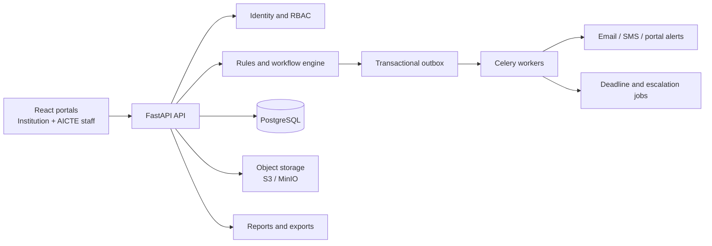
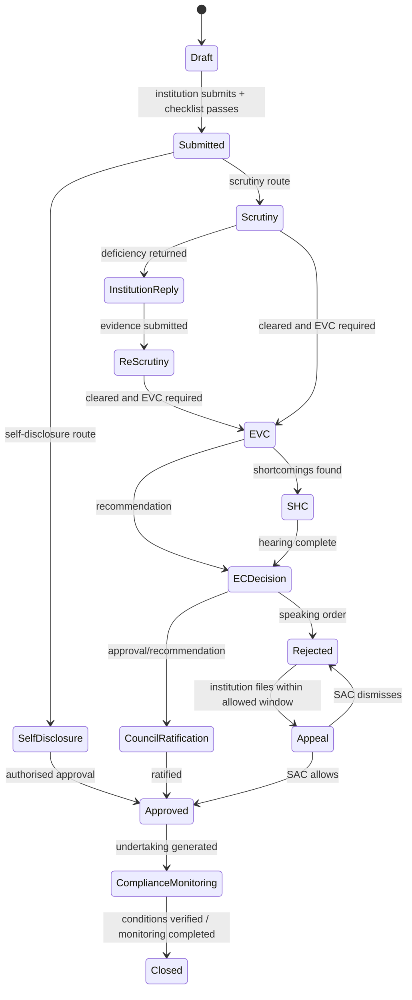

# AICTE Approval & Compliance Platform — Real Prototype Workflow

This is the implementation path for the production prototype behind the demo UI. It keeps statutory decisions with authorised people; automation routes cases, calculates deadlines, sends reminders, records evidence, and makes pending work visible.

## 1. Runtime architecture



Use a modular FastAPI monolith first. It is easier to secure, test, deploy and explain than splitting into microservices. The outbox and worker boundary lets notification, reporting and document scanning scale independently later.

## 2. Modules

| Module | Production responsibility |
|---|---|
| Identity and access | SSO/OTP login, institution registration, role and region scope, MFA for officials |
| Institution registry | Institution profile, campus, programmes, authorised signatories, existing AICTE IDs |
| Application intake | Application drafts, form versioning, document checklist, fees/payment reference, final submission |
| APH rules engine | Versioned application routes, eligibility rules, mandatory documents, stage owners, SLAs, escalation policy |
| Workflow and case management | State transitions, return/revert, assignment, delegation, notes, decisions and case summary |
| EVC operations | Eligibility queue, panel availability/conflict declaration, scheduling, visit evidence, report and shortcomings |
| Compliance passport | Undertakings, conditions, evidence, verification, remediation, closure and institution calendar |
| Document validity | Lease and prescribed-document versions, expiry calculation, renewal and legal verification |
| Notifications | Portal inbox, email/SMS templates, acknowledgement, retries and delivery history |
| Escalation and deadline service | Reminder calendar, stage ageing, due-date calculation, Bureau/EC/Council escalation |
| Appeal and SAC | Appeal filing within statutory window, evidence bundle, SAC docket, allow/dismiss/remit decision |
| Reporting and audit | Region/stage pendency, EVC status, compliance register, exports, immutable event history |
| Integration adapter | AICTE master data, payment, digital signature, SMS gateway and authorised external systems |

## 3. End-to-end case workflow



Every transition must call one service method. It validates the actor, current state, APH rule version, required evidence and linked-case blockers before writing the new state.

## 4. PostgreSQL data model

Use UUID primary keys and `created_at`, `updated_at`, `created_by` on every business table.

| Group | Core tables |
|---|---|
| Access | `users`, `roles`, `user_roles`, `institutions`, `regions`, `delegations` |
| Applications | `applications`, `application_programmes`, `application_stages`, `stage_assignments`, `deficiencies`, `case_links` |
| Rules | `aph_versions`, `workflow_definitions`, `workflow_transitions`, `document_requirements`, `deadline_policies`, `escalation_policies` |
| EVC | `evc_visits`, `evc_panels`, `evc_panel_members`, `evc_conflict_declarations`, `evc_reports`, `evc_findings` |
| Compliance | `undertakings`, `compliance_submissions`, `verification_reviews`, `document_records`, `document_versions`, `document_validity_events` |
| Alerts | `notifications`, `notification_deliveries`, `escalation_events`, `deadline_runs` |
| Decisions | `decisions`, `decision_conditions`, `appeals`, `appeal_evidence`, `sac_orders` |
| Assurance | `audit_events`, `outbox_events`, `file_objects`, `report_exports` |

Important constraints:

- `application_stages` is append-only; the active stage is selected by status and sequence.
- `audit_events` has no update/delete API and stores actor, role, IP, timestamp, action, reason, before/after JSON, and APH version.
- `document_versions` never overwrite a file. A renewal creates a new version linked to the original requirement.
- `outbox_events` and the business write are committed in one transaction.

## 5. FastAPI project layout

```text
backend/
  app/
    main.py
    api/v1/
      auth.py institutions.py applications.py workflow.py evc.py
      compliance.py documents.py appeals.py notifications.py reports.py
      admin_rules.py
    core/
      config.py security.py permissions.py database.py logging.py
    models/                 # SQLAlchemy models
    schemas/                # Pydantic request/response models
    services/
      workflow_service.py deadline_service.py evc_service.py
      compliance_service.py document_service.py appeal_service.py
      notification_service.py audit_service.py
    rules/
      evaluator.py aph_loader.py conditions.py
    workers/
      celery_app.py tasks.py
    repositories/
    migrations/             # Alembic
  tests/
  docker-compose.yml
```

## 6. Key API routes

| Area | Routes |
|---|---|
| Authentication | `POST /auth/login`, `POST /auth/refresh`, `GET /me` |
| Applications | `POST /applications`, `GET /applications`, `GET /applications/{id}`, `POST /applications/{id}/submit` |
| Workflow | `POST /applications/{id}/transitions`, `POST /applications/{id}/return`, `GET /applications/{id}/timeline` |
| Documents | `POST /documents/upload-url`, `POST /applications/{id}/documents`, `POST /documents/{id}/verify`, `POST /documents/{id}/renew` |
| EVC | `GET /evc/queue`, `POST /applications/{id}/evc/schedule`, `POST /evc/{id}/report`, `POST /evc/{id}/complete` |
| Compliance | `GET /institutions/{id}/passport`, `POST /undertakings/{id}/evidence`, `POST /undertakings/{id}/verify` |
| Appeals | `POST /applications/{id}/appeals`, `GET /appeals/queue`, `POST /appeals/{id}/decision` |
| Alerts | `GET /notifications`, `POST /notifications/read`, `GET /dashboard/my-queue` |
| Reports | `GET /reports/pendency`, `GET /reports/evc`, `GET /reports/compliance`, `POST /reports/export` |
| Rule administration | `POST /aph-versions`, `POST /workflow-definitions/publish`, `POST /deadline-policies/publish` |

For every mutating route, FastAPI dependencies must enforce: authenticated user, permitted role, applicable region/institution scope, and an idempotency key.

## 7. Deadline and notification jobs

Run these with Celery Beat or a dedicated scheduler:

1. Every hour: find stage deadlines that crossed reminder or escalation thresholds.
2. Daily: find document and undertaking expiries at 90/60/30/15/7 days.
3. Daily: re-evaluate lease gate against the academic year and maximum course duration.
4. Every 15 minutes: retry undelivered email/SMS notifications.
5. Nightly: create report snapshots and refresh dashboard aggregates.

Each job writes a deduplicated `notification_delivery` record. It must never send the same reminder twice for the same case, threshold and rule version.

## 8. Security and evidence handling

- Store uploaded files in S3/MinIO with private buckets and short-lived signed URLs.
- Run antivirus and file-type validation before a document becomes available for review.
- Hash every uploaded version and preserve its verification result.
- Apply region and institution filtering in the query layer, not only in the React UI.
- Use RBAC plus case assignment checks for transitions and verification.
- Log every view/download of sensitive evidence.
- Require reason text for rejection, return, override, remittance and conditional approval.

## 9. Implementation sequence

| Sprint | Deliverable |
|---|---|
| 1 | FastAPI foundation, PostgreSQL, Alembic, JWT/SSO adapter, RBAC, audit middleware |
| 2 | Institution registry, application intake, object storage and document checklist |
| 3 | Versioned workflow/rules engine, stage transitions, assignments and role queues |
| 4 | Deadline engine, notification outbox, portal inbox and escalation jobs |
| 5 | EVC module: panel, conflict declarations, scheduling, report and SHC routing |
| 6 | Compliance Passport, document renewal, lease gate and verification workflow |
| 7 | Decisions, conditions, appeals/SAC, reports and CSV/PDF exports |
| 8 | Integration adapters, security hardening, load tests, UAT and deployment |

## 10. First production API transaction: advance a case

```text
POST /applications/{id}/transitions
  1. Load application + active stage with row lock.
  2. Check actor role, region scope, assignment and allowed transition.
  3. Evaluate APH route and blockers, including linked closure cases.
  4. Validate required reason/evidence/committee report.
  5. Close active stage; create next stage and calculated deadline.
  6. Insert immutable audit event and outbox notification event.
  7. Commit once; worker sends notifications after commit.
```

This gives the real system the same user journey as the demo while replacing browser-only state with secure, persistent, auditable services.
